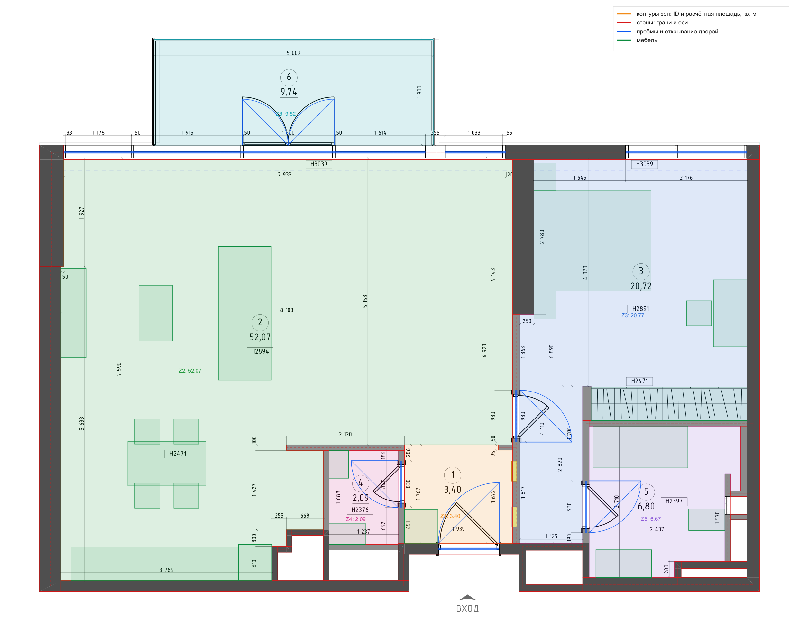
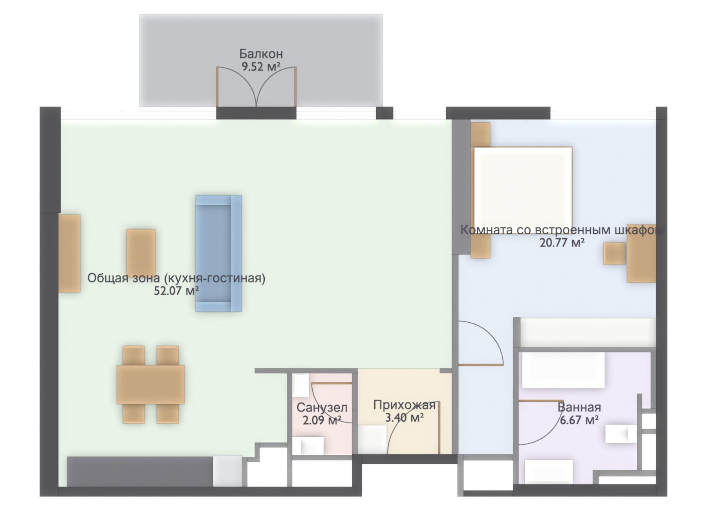

# Квартира: PDF → 3D-модель и ведомость объёмов

Пилот на одной квартире: из размеченной PDF-планировки воспроизводимо собираются
редактируемая сцена Blender и Excel-ведомость объёмов.

**Видео (81 с):** https://aslonovrgb.github.io/apartment-pdf-to-3d/ · **Архив целиком:**
[Releases](https://github.com/aslonovrgb/apartment-pdf-to-3d/releases/latest)

**Результаты сборки:** [apartment.xlsx](out/apartment.xlsx) · [apartment.blend](out/apartment.blend) ·
[overlay.pdf](out/overlay.pdf) (разметка поверх исходного PDF) · [quantities.json](out/quantities.json) ·
вариант с дверью D03 шире на 100 мм — [out_variant/](out_variant/)

| Наложение разметки на PDF | Модель Blender (вид сверху) |
|---|---|
|  |  |

## Как это работает

Планировка вручную переносится в один файл `data/plan.json`: контуры зон, стены (ось и
толщина), проёмы (стена, смещение, ширина, низ и верх), мебель. Координаты берутся из
векторного PDF по масштабу, вычисленному по концам размерных линий. Векторные линии только
помогают разметке и не считаются автоматически распознанными стенами. Перед сборкой
валидатор проверяет уникальность ID, замкнутость контуров, ссылки, размещение проёмов и
пересечения мебели. При ошибке сборка печатает ID и причину и ничего не публикует. Из
того же `plan.json` скрипт Blender строит сцену с пустыми проёмами, а Python считает
площади, периметры и стены по внутренним граням. Excel только генерируется и вручную не
правится. Поэтому любое изменение разметки (например, дверь шире на 100 мм) одной командой
даёт согласованные модель и ведомость. Наложение разметки на исходный PDF и лист «Сверка с
PDF» показывают, где расчёт совпадает с подписями чертежа, а где источник противоречит сам
себе.

## Запуск

Нужны Python ≥ 3.9 и Blender (проверено на 5.2 LTS; путь можно задать переменной `BLENDER`).
Внешние API не используются.

```bash
make            # venv + зависимости, тесты, сборка в out/
```

Без make:

```bash
python3 -m venv .venv && .venv/bin/pip install -r requirements.txt
.venv/bin/python -m pytest -q
.venv/bin/python build.py            # data/plan.json → out/
```

| Результат в `out/` | Что внутри |
|---|---|
| `apartment.xlsx` | листы «Объёмы», «Стены по граням», «Проёмы», «Мебель», «Сверка с PDF», «Допущения», «Источник» |
| `apartment.blend` | коллекции Walls, Floors, Windows, Doors, Furniture, Labels, Cameras; у объектов имя и свойство `plan_id` из plan.json |
| `top.png`, `iso.png` | вид сверху и изометрия (Workbench) |
| `overlay.pdf`, `overlay.png` | разметка поверх исходного листа PDF |
| `quantities.json` | те же значения в машиночитаемом виде (для сравнения сборок) |
| `plan.json` | копия входа, из которого собран результат |

Другие команды:

```bash
make check             # только проверка, Excel и наложение (без Blender) → out_check/
make demo DOOR=D03     # копия входа с дверью шире на 100 мм → out_variant/, таблица до/после и compare_D03.png
python tools/pdf_inspect.py data/source/projectfortest.pdf --out work/pdf   # вектор и тексты PDF для разметки
.venv/bin/python video/build_video.py   # демо-видео ≈ 80 с из результатов сборки (после make и make demo)
```

Видео собирается скриптом из тех же результатов: исходный PDF, `out/overlay.pdf`, облёт
`out/apartment.blend` в Blender, вывод `make demo DOOR=D03`, `compare_D03.png` и ячейки
`out_variant/apartment.xlsx`. Озвучка синтезирована голосом macOS (Milena), текст —
`video/narration.txt`. Нужны ffmpeg и Blender.

## Структура

```
data/plan.json            единственный источник геометрии (мм)
data/source/              исходный PDF
build.py                  одна команда: проверка → Excel → наложение → Blender → публикация
src/aptplan/              geometry, model, validate, quantities, report, excel, overlay, layout
blender/build_scene.py    построение сцены (чистый bpy + src/aptplan без внешних библиотек)
scripts/demo_change.py    сквозная проверка изменения на копии входа
tools/pdf_inspect.py      помощник разметки
tests/                    эталонная комната 4×3 м, изменение двери, проверки входа, сверка разметки
video/                    сборка демо-видео (build_video.py, blender_orbit.py, narration.txt)
```

## plan.json (схема 1.0)

Единицы — мм, ось X вправо, Y вверх; начало координат и масштаб записаны в `source`.

- `source`: файл, страница, `sha256` (защита от другой версии чертежа), `scale.pt_per_m` и
  калибровка по размерным линиям, `origin.pdf_pt`.
- `zones[]`: `id`, `name`, `kind` (`interior` | `balcony`), замкнутый `polygon` по внутренним
  граням, `ceiling_height_mm` и `height_source`, `reference` (подпись на плане, строка
  экспликации), необязательные `ceiling_regions` — выпуклые участки с другой высотой потолка
  (например, под ГКЛ), обрезаются по контуру зоны.
- `walls[]`: `start`/`end` по оси (концы в точках пересечения осей), `thickness_mm`, `kind`.
- `openings[]`: `type` (`door` | `window` | `doorway`), `wall`, `offset_mm` от начала стены
  до ближнего откоса, `width_mm`, `sill_mm`, `head_mm`; у дверей `hinge` (`start` | `end`),
  `swing` (`left` | `right` относительно направления стены) и `leaves` (1 | 2).
- `furniture[]`: `type`, `zone`, `center`, `size_mm` [ширина, глубина, высота],
  `rotation_deg` (0° — спинка к +Y), необязательная `group` (стол и стулья могут перекрываться).
- `controls[]`: контрольные размеры чертежа между гранями стен.
- У каждого значения есть источник: `pdf_dimension` (размер PDF), `scaled` (измерено по
  масштабу) или `assumption` (допущение).

## Правила расчёта

- Пол — площадь контура зоны, периметр — сумма его рёбер.
- Потолок — горизонтальная проекция, разбита по высотам участков. Вертикальные грани
  перепадов не прибавляются.
- Стены — по внутренним граням. Ребро контура считается стеной там, где оно лежит на
  грани стены (ось ± толщина/2, допуск 25 мм) или на открытом торце стены (уступы, концы
  перегородок). Граница между зонами без перегородки — не стена. Брутто = Σ длина × высота
  потолка над этим участком грани, нетто = брутто − проёмы.
- Проём вычитается из каждой отделываемой грани, которую пересекает (дверь между комнатами
  уменьшает обе грани). Двери и окна считаются по уникальным ID.
- Плинтус — отделываемые грани стен на уровне пола минус проёмы, начинающиеся от пола (двери,
  проёмы без заполнения, витраж в пол). По открытым границам зон плинтуса нет.
- Балкон — отдельными строками, во внутренний итог не входит.
- Неизвестные высоты помечаются как допущения, а не выдаются за обмеры.

Формулы проверены автотестами: `tests/test_quantities.py` и `tests/test_features.py`
(участки потолка, торцы стен, двустворчатые двери, сверка реальной разметки). Комната 4 × 3 м, H = 2,8 м, дверь
0,9 × 2,1 м даёт 12 м² пола, 14 м периметра, 39,20 м² стен брутто и 37,31 м² нетто. Если
расширить дверь на 100 мм, нетто каждой затронутой грани уменьшается на 0,21 м², а пол,
периметр и число дверей не меняются.

## Результат по квартире (projectfortest.pdf)

Масштаб 1:50 (56,693 pt/м) подтверждён по размерам 5009, 7933, 8103 и 1900 — отклонение
меньше 0,01 %. Начало координат — внутренний угол левой и нижней наружных стен. Разметка:
6 зон, 31 стена, 5 дверей, 5 окон, 22 предмета мебели, 22 контрольных размера.

| Зона | Название | Расчёт, м² | Подпись на плане | Экспликация | Статус |
|---|---|---|---|---|---|
| Z1 | Прихожая | 3,40 | 3,40 | — | совпадает |
| Z2 | Общая зона (кухня-гостиная) | 52,07 | 52,07 | — | совпадает |
| Z3 | Комната со встроенным шкафом | 20,77 | 20,72 | — | совпадает (0,24 %) |
| Z4 | Санузел | 2,09 | 2,09 | 2,09 | совпадает |
| Z5 | Ванная | 6,67 | 6,80 | 6,73 | проверить (−1,9 %) |
| Z6 | Балкон | 9,52 | 9,74 | 9,50 | проверить (−2,3 %) |
| | Итого с балконом | 94,52 | 94,82 | 93,56 | |

Квартира без балкона: пол 85,00 м², плинтус 60,95 м, стены брутто 202,85 м², проёмы 42,22 м²,
стены нетто 160,63 м². Балкон отдельно: пол 9,52 м², стена 1,48 м² нетто.

Что выяснилось при сверке:

- Экспликация не описывает этот план. В ней 7 строк и другая нумерация: строка 2 —
  «Санузел 2,09», а зона 2 на плане — 52,07 м². Ещё в ней есть помещения, которых на обмерном
  плане нет: прихожая 9,87, кухня-гостиная 35,45, спальня №2 17,50. Перегородки из
  экспликации не добавлены. Однозначно сопоставлены только санузел, ванная и балкон.
- Балкон: подпись 9,74 = внешний контур рамы остекления (5059 × 1925). Размеры 5009 × 1900
  дают 9,52, что сходится с экспликацией (9,50). В модели — по размерам.
- Ванная: короб с ревизионным люком в зону не включён. Размеры 2710 и 280 на 10 мм меньше
  нарисованных стен.
- Размер 7590 (контроль C20) — до рамы витража. Грань стены взята по линии 7560: только с
  ней подпись 52,07 сходится точно. Остальные 21 контрольный размер совпадают, отклонение
  не больше 10 мм.
- В зонах 2 и 3 потолок разной высоты по линиям свеса ГКЛ: H2471, H2894 (H2891) и H3039.
  Стены считаются по высоте участка, над которым проходит грань.

Главные допущения (полный список — лист «Допущения»):

- витраж от пола до потолка, секции между осями импостов считаются окнами;
- высота дверей 2100 мм, балконной двери 2400 мм;
- прихожая H2471 (своей отметки на плане нет);
- балкон H3039.

Все допущения меняются в `plan.json` и пересчитываются одной командой.

`make demo DOOR=D03`: дверь между общей зоной и комнатой шире на 100 мм. Нетто граней
`Z2/e10/W21` и `Z3/e9/W21` уменьшается на 0,21 м² каждая. Пол, периметр и число дверей не
меняются.

## Переход на сто проектов

Схема `plan.json` и движок расчёта остаются прежними, меняется только способ получить
`plan.json`. Импорт векторных PDF (линии и штриховки стен, тексты размеров) и сканов (CV)
делается отдельными модулями. Каждый предлагает разметку с оценкой уверенности, а
элементы с низкой уверенностью уходят в очередь ручной проверки на том же наложении.
Качество измеряется на тестовой выборке с разной графикой, масштабом и качеством по
точности контуров и проёмов (мм, доля найденных) и по времени ручной правки на проект.
Полную автоматизацию обещать до таких тестов нельзя.

## Ограничения пилота

Стоимость работ, инженерные сети, автоматический разбор произвольного PDF и
фотореалистичный рендер в объём не входят. Мебель — упрощённые блоки для проверки
расстановки и проходов.
